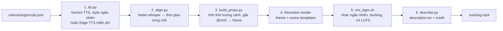

# Dan Tech Video

## Định hướng

**dantech-video là engine video ngắn của Dan Tech, cho video 45–120 giây.** Trọng tâm của dự án là **viết kịch bản xuất sắc**; phần dựng hình là code cố định.

- **Kim chỉ nam:** người xem nhận được giá trị thật, không thấy chán, và xem tới cuối.
- **Điều kiện tiên quyết cho mọi script:** ý phải **trọn vẹn và mạch lạc**: vấn đề → giải thích / giải pháp → payoff. Không bao giờ rời rạc hay là một đống ý không nối với nhau. Không cắt tới mức ý bị đứt mạch, cũng không nhồi cả bài học.
- **Nguồn cần hơn ~120 s:** người viết **dừng và xác nhận với người yêu cầu trước khi viết**, đưa 3 lựa chọn: (a) rút gọn theo một hướng cụ thể, (b) chia thành nhiều video, mỗi video tự đứng được và trọn vẹn, (c) hỏi mục đích / mục tiêu của video để quyết định giữ gì. Chỉ khi không ai trả lời được mới tự chọn mặc định hợp lý và nêu lý do.
- Chi tiết: skill [`write-script`](.agents/skills/write-script/SKILL.md), mục "Độ dài 45–120 s, ý phải trọn vẹn".

Repo dựng video dọc ngắn (1080×1920, 30 fps) cho kênh Dan Tech. Anh viết **một file `script.json`**, chạy **một lệnh**, nhận video hoàn chỉnh: giọng đọc AI, phụ đề theo từng chữ, chuyển cảnh, SFX, nhạc nền, nút Follow và end card, cộng thêm `description.txt` có sẵn dòng credit và nguồn.

Có 3 theme:

| Theme | Dùng cho | Trạng thái |
|---|---|---|
| `hot-news` | Tin nóng, drama công nghệ (phong cách báo in: giấy, đỏ, Anton) | ✅ Đã duyệt (khoá) |
| `quick-tips` | Mẹo, tutorial, review tool AI, listicle (cobalt + vàng, keycap, mockup IDE) | ✅ Đã duyệt |
| `tech-explain` | Dev explainer: git, code, terminal (thanh tab vàng, gutter số dòng, lệnh gõ chữ, git graph, git log, chuyển cảnh `scroll`) | ✅ Đã duyệt |
| `tech-explain-cyber` | GIẢI THÍCH CYBER: dev explainer kiểu blueprint tối (nền #1C1C1C, accent lime, sơ đồ tự vẽ, terminal, cây thư mục); ví dụ `videos/flutter-mvvm` | ✅ Đã duyệt |
| `hot-news-glitch` | TIN NÓNG GLITCH: tin nóng nền tối #1C1C1C, đỏ tín hiệu #FF2D2D, glitch "tín hiệu vỡ" chỉ ở khoảnh khắc nhấn + chuyển cảnh `signal`; ví dụ `videos/openai-vs-apple-glitch` | ✅ Đã duyệt |
| `android-tutor` | ANDROID TUTOR: chỉ cho dev Android. Studio Dark (nền gần đen #0B0C0E, card #17181B, màu cú pháp Kotlin kiểu IDE, tab editor, Logcat D/I/W/E) + Compose Preview (code cạnh khung điện thoại chạy @Preview), accent đúng xanh Android chính thức #3DDC84 (không dùng tông pastel), chuyển cảnh `sharedx` (Material shared-axis X như điều hướng Android) + tiếng `slide_soft` rất nhẹ, spring M3 Expressive cho phần tử, hình mid-ground morph chậm liên tục. Font Google Sans Flex + JetBrains Mono (OFL, `assets/fonts/licenses/`). Ví dụ `videos/compose-remember-saveable` | ✅ Đã duyệt |
| `flutter-tutor` | FLUTTER TUTOR: chỉ cho dev Flutter/Dart. Layered Blue: nền navy gần đen #050A14, surface navy nâng bậc, đúng 3 màu Flutter chính thức Navy #042B59 / Blue #0553B1 / Sky #027DFD, card widget lồng nhau (Scaffold → Column → Text) sáng lên khi build lại, code card Dart, cặp số liệu. Chuyển cảnh `hero` (chip từ khoá bay theo cung nhẹ sang cảnh sau, phần còn lại cross-fade, Curves.fastOutSlowIn) + `hero_soft` rất nhẹ; dải xanh chéo mid-ground trượt chậm, đổi góc/bo. Logomark Flutter chính thức nhỏ, không chỉnh sửa (`assets/brand/flutter/`), ™ + dòng trademark ở end card. Font Google Sans Flex + Google Sans Code (OFL). Ví dụ `videos/flutter-setstate-valuenotifier` | ✅ Đã duyệt |
| `loot-crypto` | LOOT CRYPTO (fanpage khách hàng, brand riêng, không phải Dan Tech): crypto news / phân tích coin / kiến thức / hướng dẫn ví & bảo mật / giá & on-chain. Studio 3D: plate dựng sẵn (tools/loot-3d: khối graphite + mint bóng trên sàn tối, 1 vũng sáng, rim lạnh, DoF nông) chỉ trôi chậm; hình học từ logomark (3/4 đĩa + ô vuông mint): card 3 góc tròn + 1 góc nhọn phải-trên, ô vuông mint làm bullet, vạch đỏ ngắn trên tiêu đề. Mint #3BE08F accent/tăng, đỏ #E6322D giảm/cảnh báo, off-white #F5F5F2, nền #08080A. Font Sora SemiBold (logo, số, ticker, chỉ Latin) + Be Vietnam Pro ExtraBold/Medium/SemiBold. Chuyển cảnh `quarter` (cung 90° quét quanh góc dưới-trái) + `quarter_soft`. Brand/CTA/handles từ `channels/loot-crypto.json` (theme.json `channel`). Disclaimer "Không phải lời khuyên đầu tư" tự hiện ở header cảnh giá/biểu đồ/coin/flow + end card; số liệu gắn tag MINH HỌA nếu không có nguồn. Ví dụ `videos/loot-vi-nong-vi-lanh` | 🧪 Chờ duyệt |
| `duoly` | Duoly in Love (fanpage khách hàng về tình yêu / cặp đôi, không phải Dan Tech). Kiểu A + B: plate hồng mềm (#FFF6F4→#FBE3E1) với tim phồng + nhẫn đôi 3D bóng (tools/duoly-3d, three.js headless) trôi nhẹ ở dải trên/dưới; nội dung kể bằng bong bóng chat + sticker. Palette #D80B46 / #E72055 / #F35570 / #F78E78 / #F7C4C1 / #FBE6E4 / trắng, chữ thân #5B1F33. Be Vietnam Pro ExtraBold/Medium. Scene: DlHook, DlChat, DlLove ("yêu là…"), DlQuiz (A/B/C + tag), DlDays (đếm ngày), DlTips (chip giá), DlDistance (2 ghim, km, 2 múi giờ), DlVersus (phe chị em + poll). Chuyển cảnh `drift` (crossfade + nhích lên, không zoom) + `drift_soft`, `bubble_soft` cho bong bóng. Giọng nữ Edge `vi-VN-HoaiMyNeural` mặc định từ theme.json `tts`. Không nhắc app, không link; end card chỉ logo + "Duoly in Love". Ví dụ `videos/duoly-demo` | 🧪 Chờ duyệt |

Id cũ `tin-nong`, `meo-nhanh`, `commit` vẫn được chấp nhận (alias, deprecated). Giao diện `~/commit` / `DAN/TECH.git` của GIẢI THÍCH là phong cách editor, không phải tên theme.

## Pipeline



Mọi bước ghi kết quả vào `videos/<slug>/out/` (không commit). Voice và nhạc đã chọn được ghi vào `logs/voice_log.md`.

## Cài đặt (một lần)

```bash
# cần: Node 18+, Python 3.10+, ffmpeg
cd remotion && npm install && cd ..
pip install -r requirements.txt          # faster-whisper (tải model "medium" ~1.5 GB lần đầu)
./dt fetch-music                         # tải nhạc Wikimedia Commons về assets/music/
# Nhạc Pixabay (7 bài TIN NÓNG) phải tải tay từ pixabay.com vào assets/music/pixabay/ (xem assets/music/LIBRARY.md)
export GEMINI_API_KEY=...                # tuỳ chọn, chỉ đọc từ biến môi trường, KHÔNG bao giờ ghi vào repo. Không có key → Edge TTS miễn phí
./dt setup                               # (hoặc make setup) tự cài phần còn lại: .venv, npm, model whisper, .env, nhạc
./dt doctor                              # (hoặc make doctor) kiểm tra máy: ✅/❌ kèm cách sửa
```

**Dùng với AI CLI trên máy (Grok CLI, Claude Code, Codex…):** AI đọc [`AGENTS.md`](AGENTS.md) (CLAUDE.md, GROK.md trỏ về đó). AI chỉ viết `script.json` và chạy lệnh, còn lại là code cố định. Có sẵn skills `setup`, `write-script` (có bước `humanizer`, MIT, từ blader/humanizer), `render-video`, `theme` trong `.agents/skills/` (`.claude/skills`, `.grok/skills` là symlink tới đó; Windows cần `git config core.symlinks true` + Developer Mode). Kiểm script trước khi render: `python3 scripts/validate_script.py <script>`.

## Làm một video, từng bước

1. Tạo thư mục `videos/<slug>/` và copy một `script.json` mẫu (`videos/openai-vs-apple/` cho TIN NÓNG, `videos/android-studio-shortcuts/` cho MẸO NHANH, `videos/git-merge-vs-rebase/` cho GIẢI THÍCH).
2. Sửa `script.json`:
   - `theme`, `title`, `date` (hiện trên masthead), `caption`, `sources` (đi vào description).
   - `scenes`: mỗi cảnh có `say` (câu giọng đọc nói trong cảnh đó), `type` (scene template), `section` (dòng nhỏ trên đầu trang), `out` (kiểu chuyển cảnh sang cảnh sau: `page`, `bar`, `zoom`, `push`, `stack`, `morph`, `scroll`), `props` (nội dung cảnh), `sfx` (tuỳ chọn).
   - Câu cuối nên có `ctaPhrase` của kênh (mặc định "follow Dan Tech"): nút Follow tự bật lên ở `ctaInWord` ("follow") và được bấm đúng `ctaPressWord` ("Dan".
3. Chạy:
   ```bash
   make video SCRIPT=videos/<slug>/script.json      # hoặc: ./dt render videos/<slug>/script.json
   ```
4. Lấy `videos/<slug>/out/<slug>.mp4` và `description.txt`.
5. Sửa một chỗ rồi muốn chạy lại nhanh: `./dt render <script> --from props` (bỏ qua TTS + align), hoặc `--from mix` (chỉ trộn lại nhạc).

### Hẹn giờ theo chữ: `@chữ`
Trong `props` và `sfx`, số là frame tính từ đầu cảnh (30 frame = 1 giây). Thay vì đếm frame, viết `"@chữ"`:
- `"@Shift"`: lúc giọng đọc bắt đầu nói "Shift" (lần đầu tiên trong cảnh)
- `"@Enter#2"`: lần thứ 2 chữ "Enter" xuất hiện trong cảnh
- `"@L+4"`, `"@follow-6"`: lệch thêm/bớt vài frame
- `"@nhé.end"`: lúc chữ kết thúc

Nhờ vậy khi đổi giọng (thời lượng khác), keycap, popup, SFX vẫn khớp giọng nói. Vài cue trong ví dụ TIN NÓNG (thứ tự checklist, tick đếm) là số frame cố định vì đó là nhịp hình ảnh, không phải theo chữ.

## Chỉnh giọng / nhạc / SFX ở đâu

| Muốn đổi | Sửa ở |
|---|---|
| Giọng (voice id, model, danh sách style) | `themes/<theme>/theme.json` → `voice` |
| Chọn style cho một video | `script.json` → `"voice": {"style": "random" \| "hao-hung" \| "ke-chuyen" \| "tu-nhien"}` |
| Engine TTS (Gemini / Edge miễn phí) | `./dt render <script> --tts edge\|gemini`, hoặc `"tts": {"engine":"edge","voice":"vi-VN-NamMinhNeural","rate":"+10%"}`. Mặc định: có key → Gemini, không → Edge |
| Dùng file ghi âm có sẵn (không gọi TTS) | `"voice": {"file": "voice_approved.mp3"}` (đường dẫn trong thư mục video) |
| Danh sách nhạc xoay vòng của theme + đoạn bắt đầu | `themes/<theme>/theme.json` → `music.pool` |
| Nhạc cho một video | `"music": {"track": "random" \| "<id trong tracks.json>", "start": 7}` (random = bài lâu chưa dùng nhất trong pool, theo log) |
| Nhạc to/nhỏ dưới giọng | `theme.json` → `music.rel` (dB so với giọng trước khi duck; -9 TIN NÓNG, -11 MẸO). Chuỗi xử lý ở `scripts/mix_bgm.sh` |
| SFX một khoảnh khắc | `script.json` → `scenes[].sfx`: `{"at": "@chữ", "s": "tên file trong assets/sfx", "v": 0.5}`, tick lặp: thêm `"every": 5, "count": 14` |
| SFX chuyển cảnh của theme | `theme.json` → `look.sfx.trans` |
| Màu, font, kiểu chữ | `theme.json` → `look` |
| Biến thể màu (vd GIẢI THÍCH đỏ) | `theme.json` → `variants.<tên>.look`; dùng: `"variant": "red"` trong script.json (hoặc `"look": {...}` ghi đè riêng 1 video) |
| Tagline end card, vị trí nút Follow, thời gian giữ cuối | `theme.json` → `outro`, `cta`, `tail_hold` |
| Handle mạng xã hội | `channels/<id>.json`, mặc định `dantech` (YouTube @dantech-0xff, Facebook @dantech0xff, TikTok @dantech_0xff, có logo). Ghi đè từng video bằng `"handles"` trong script nếu thật cần |
| Logo thương hiệu | Tự động, không khai báo: `build_props` phát hiện tên sản phẩm trong lời + chữ trên hình (`scripts/brands.py`, registry `assets/brand/registry.json`), tải logo chính thức (Simple Icons → trang chủ → GitHub → Wikimedia; `scripts/brand_logo.py`, cache `assets/brand/<slug>/`) rồi đặt cạnh tên trong cảnh hoặc bằng brand chip; end card có dòng "Logo thuộc về chủ sở hữu tương ứng." Tắt: `brands_off` / `brands_skip`. |

Độ dài: **45–120 s lời đọc**, ý trọn vẹn (xem "Định hướng" ở đầu file và write-script "Độ dài 45–120 s, ý phải trọn vẹn"). Ngoài khoảng này có chủ đích: `"long_ok": true` / `"short_ok": true`. Giọng đọc: gọi TTS **một lần** cho mỗi video và giữ style đã rút, không gọi lại để chỉnh độ dài. Lời không đổi thì dùng lại cache `.cache/tts/` (cùng audio, cùng style). Muốn giọng mới: `./dt render <script> --new-voice`.

Kiểm tra mix: `./dt render` in ra "voice/music while speaking: median ~21 dB" (mục tiêu 18-22 dB). Loudness cuối: -14 LUFS, true peak ≤ -1 dBTP.

## Thêm theme mới

1. Copy `themes/quick-tips/` thành `themes/<id>/`, sửa `theme.json` (màu, font, transition SFX, nhạc, tagline).
2. Font mới: bỏ file vào `assets/fonts/` và thêm `@font-face` trong `FONTS` (`remotion/src/sys.tsx`).
3. Đăng ký theme trong `remotion/src/themes.ts` (import JSON) và thêm id vào danh sách trong `remotion/src/Root.tsx`.
4. Dùng scene template có sẵn hoặc viết template mới trong `remotion/src/` rồi thêm vào bảng `SCENES` ở `remotion/src/Video.tsx`.

## Cấu trúc repo

```
dt, Makefile            lệnh chính
themes/<id>/theme.json  màu/font/transition/giọng/nhạc/outro của từng theme
remotion/src/
  Video.tsx             component chung cho mọi theme (đọc props.json)
  Root.tsx              1 composition / theme
  sys.tsx               captions, chuyển cảnh (Timeline), masthead, hiệu ứng vào/ra
  scenes.tsx            scene templates TIN NÓNG/GIẢI THÍCH: Headline, Flow, Quote, Checklist, Evidence, CTA
  commit.tsx            scene templates GIẢI THÍCH: CmdHook, GitGraph, LogPanes, DocRule, CommitCTA, CodeBlock, DepGraph, Analogy, Inversions, KeyPoint
  meo.tsx               scene templates MẸO NHANH: MeoHook, MeoSearch, MeoFix, MeoSlowFast, MeoSave, keycap, IDE mockup
  outro.tsx             nút Follow (bấm + chuông) và end card
scripts/                tts.py, align.py, build_props.py, pick_music.py, mix_bgm.sh, loudnorm.sh, describe.py, measure_vm.py, compare.sh, fetch_music.py
assets/                 fonts/, sfx/ (+SFX_LIST.md), music/ (LIBRARY.md, tracks.json), broll/, textures/
videos/<slug>/          script.json (+ voice_approved.mp3 nếu ghim giọng); out/ là output
logs/voice_log.md       nhật ký giọng + nhạc
```

## Bản quyền & credit

- **Nhạc Wikimedia Commons** (CC BY 3.0/4.0): bắt buộc ghi credit trong description, `describe.py` tự thêm. Content ID chưa kiểm tra (`unknown`).
- **Nhạc Pixabay** (Pixabay Content License): không bắt buộc credit (vẫn ghi). Bài 4-7 trong rotation TIN NÓNG đã đăng ký Content ID, có thể bị claim; description sẽ cảnh báo.
- **SFX Kenney**: CC0 1.0, không bắt buộc credit. `whoosh_soft`, `outro_sting`: tự tổng hợp bằng ffmpeg. Chi tiết: `assets/sfx/SFX_LIST.md`.
- **B-roll** (`assets/broll/`: búa toà án, ổ cứng): clip AI, không có người/khuôn mặt. Quy tắc kênh: không dùng người hay khuôn mặt AI.
- **Fonts**: Anton, Barlow, Be Vietnam Pro, JetBrains Mono (SIL Open Font License).
- **Giọng đọc**: Gemini TTS (`vi-vn-concierge-2`), hoặc Edge TTS miễn phí (`edge-tts`, `vi-VN-NamMinhNeural`) khi không có key / `--tts edge`.
